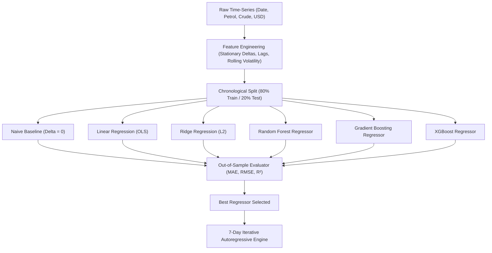
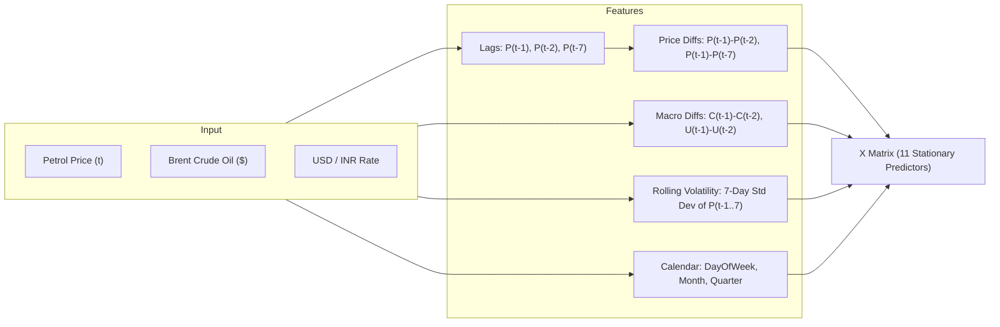
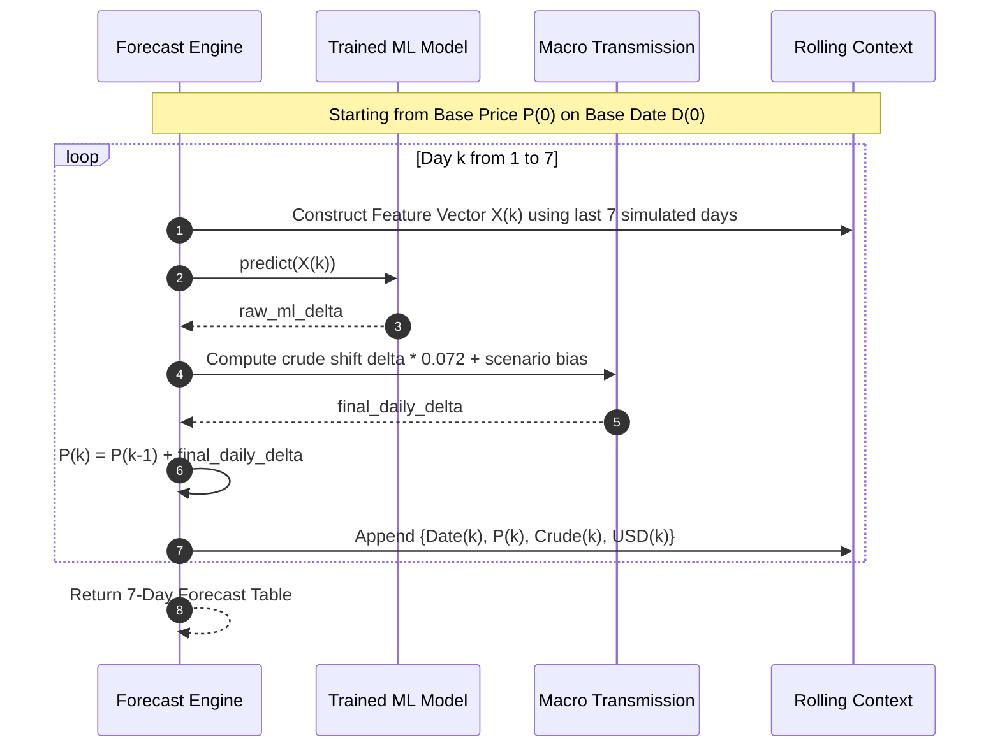
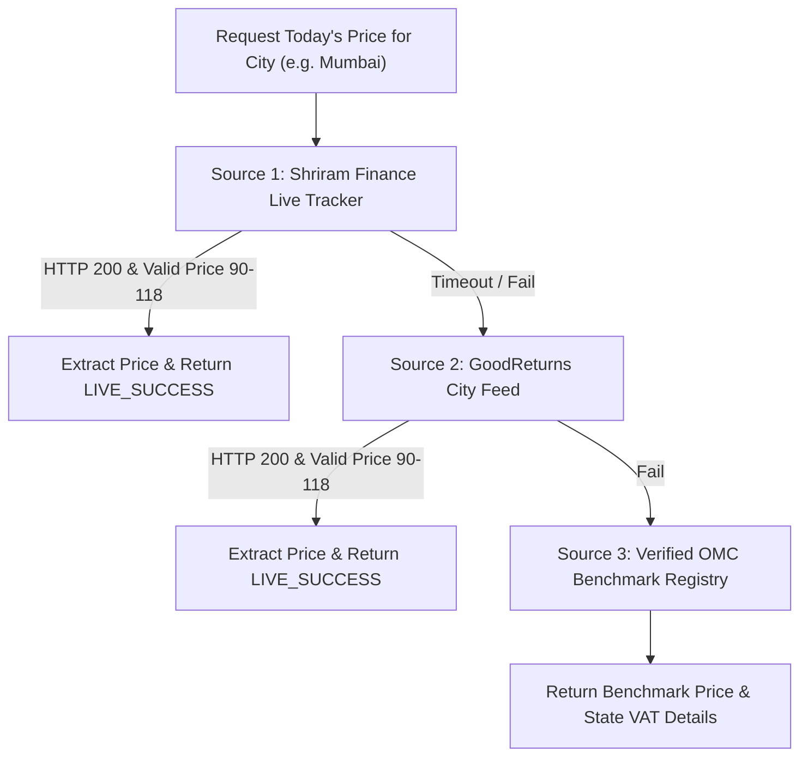
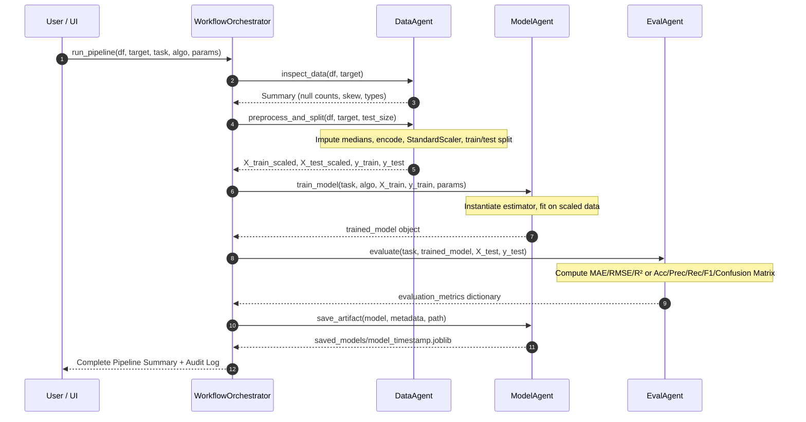

# ⛽ Commodity AI & Multi-Agent ML Studio: Deep-Dive Project Explanation

An in-depth technical architectural manual and guide explaining the design, directory structure, algorithms, mathematical formulations, and internal execution mechanics of the **Commodity & Fuel Price Forecasting Terminal & Multi-Agent Machine Learning Studio**.

---

## 📑 Table of Contents
1. [Executive Summary](#1-executive-summary)
2. [Repository Structure & Component Breakdown](#2-repository-structure--component-breakdown)
3. [Machine Learning Algorithms Utilized](#3-machine-learning-algorithms-utilized)
   - [Time-Series Fuel Price Forecasting Algorithms](#time-series-fuel-price-forecasting-algorithms)
   - [Multi-Agent Studio Algorithms](#multi-agent-studio-algorithms)
4. [Internal Mechanics: How the System Works Step-by-Step](#4-internal-mechanics-how-the-system-works-step-by-step)
   - [The Non-Stationarity & Tree Extrapolation Problem](#the-non-stationarity--tree-extrapolation-problem)
   - [Feature Engineering Pipeline & Anti-Leakage Design](#feature-engineering-pipeline--anti-leakage-design)
   - [Iterative 7-Day Autoregressive Roll-Forward Engine](#iterative-7-day-autoregressive-roll-forward-engine)
   - [Macroeconomic Transmission & Market Scenarios](#macroeconomic-transmission--market-scenarios)
   - [Multi-City Live Scraper & Fallback Registry](#multi-city-live-scraper--fallback-registry)
   - [Autonomous Multi-Agent Pipeline Mechanics](#autonomous-multi-agent-pipeline-mechanics)
5. [Evaluation Metrics & Model Verification](#5-evaluation-metrics--model-verification)
6. [How to Run and Test the System](#6-how-to-run-and-test-the-system)

---

## 1. Executive Summary

This project is a production-grade Machine Learning terminal built on Python and Streamlit, divided into three specialized operational modules:

1. **⛽ Module 1: Retail Petrol Price Predictor (Multi-City)**
   - Ingests chronological daily market observations (retail fuel prices, Brent crude oil benchmark in USD, and USD/INR exchange rate).
   - Scrapes real-time fuel rates across 10 major Indian metropolitan hubs (Ahmedabad, Surat, Vadodara, Rajkot, Mumbai, Delhi, Bengaluru, Hyderabad, Chennai, Kolkata).
   - Generates iterative, 7-day forward price forecasts with bi-directional price movements (price cuts, flat OMC regulated pauses, and price hikes) driven by macroeconomic transmission modeling.

2. **📊 Module 2: Model Performance & Live Benchmarking**
   - Evaluates machine learning models chronologically (out-of-sample) against a persistent Naive baseline.
   - Real-time accuracy tracking: compares model 1-step ahead predictions directly against today's live scraped retail price.

3. **🤖 Module 3: Multi-Agent Machine Learning Studio**
   - An autonomous, agent-based machine learning pipeline where specialized agents (`DataAgent`, `ModelAgent`, `EvalAgent`) collaborate under a master `WorkflowOrchestrator` to ingest, clean, train, evaluate, and serialize classification and regression models on arbitrary user-uploaded tabular datasets.

---

## 2. Repository Structure & Component Breakdown

```
d:\Projects\ml project\
├── .gitignore                         # Git exclusion rules (virtualenvs, binaries, caches)
├── README.md                          # Repository overview & quickstart guide
├── PROJECT_EXPLANATION.md             # Complete technical architecture & algorithmic manual
├── requirements.txt                   # Core Python library dependencies
├── app.py                             # Unified Streamlit UI & Interactive Terminal
│
├── data/
│   └── ahmedabad_petrol_daily.csv     # 1,216 daily chronological records (2021-2024)
│
├── petrol_module/                     # Dedicated Time-Series Fuel Forecasting Module
│   ├── __init__.py                    # Public API exports
│   ├── data_loader.py                 # Chronological data ingestion & forward-fill cleaning
│   ├── feature_engineering.py         # Stationary delta creation, rolling stats, lag generators
│   ├── models.py                      # Naive Baseline, Linear, Ridge, Random Forest, XGBoost
│   ├── evaluator.py                   # Out-of-sample chronometric evaluation (MAE, RMSE, R²)
│   ├── forecast.py                    # 7-day iterative roll-forward engine with macro transmission
│   └── live_fetcher.py                # Real-time multi-city web scraper & OMC fallback registry
│
├── agents/                            # Multi-Agent Cooperative ML System
│   ├── __init__.py                    # Module export definitions
│   ├── data_agent.py                  # Ingestion, missing value imputation, scaling, splits
│   ├── model_agent.py                 # Algorithm dispatching, hyperparameter tuning, model training
│   ├── eval_agent.py                  # Classification and regression metrics calculation
│   └── orchestrator.py                # Pipeline lifecycle orchestrator, timers, logging
│
├── saved_models/                      # Serialized ML model artifacts (.joblib)
│   └── .gitkeep                       # Preserves folder in version control
│
└── .streamlit/
    └── config.toml                    # Executive dark theme configuration
```

### Detailed File Responsibilities

| File | Purpose & Responsibilities |
| :--- | :--- |
| `app.py` | Orchestrates the web dashboard. Manages UI state, tab navigation, Plotly interactive visualizations, metric KPI cards, and user scenario simulations. |
| `petrol_module/data_loader.py` | Ingests CSV data, enforces datetime indexing, sorts sequentially, forward-fills gaps, and eliminates lookahead bias. |
| `petrol_module/feature_engineering.py` | Transforms raw price levels into stationary daily deltas ($\Delta P_t$). Generates autoregressive price lags, crude lags, foreign exchange rates, rolling standard deviations, and calendar features. |
| `petrol_module/models.py` | Encapsulates the suite of models: `NaiveBaselineModel`, `LinearRegression`, `Ridge`, `RandomForestRegressor`, `GradientBoostingRegressor`, and `XGBRegressor`. |
| `petrol_module/evaluator.py` | Executes out-of-sample temporal validation on the test split. Computes Mean Absolute Error (MAE), Root Mean Squared Error (RMSE), and percentage improvement over the Naive baseline. |
| `petrol_module/forecast.py` | Runs an autoregressive loop across a 7-day horizon. Computes economic pass-through from Brent crude oil adjustments ($\approx 0.072~\text{INR/L}$ per $\$1$ crude swing), adjusts for market regimes, and rolls prices forward day-by-day. |
| `petrol_module/live_fetcher.py` | Multi-source web scraper targeting live fuel rates from Shriram Finance and GoodReturns. Houses a verified city benchmark dictionary with state VAT rates across 10 Indian cities. |
| `agents/data_agent.py` | Inspects data distributions, separates numerical/categorical columns, imputes missing values with median/mode, standardizes features via `StandardScaler`, and performs stratified/train-test splits. |
| `agents/model_agent.py` | Instantiates models according to task type (`regression` or `classification`) with customizable hyperparameters, trains the estimator, and serializes artifacts via `joblib`. |
| `agents/eval_agent.py` | Computes comprehensive diagnostics: $R^2$, MAE, MSE, RMSE for regression; Accuracy, Precision, Recall, F1-Score, and Confusion Matrices for classification. |
| `agents/orchestrator.py` | Executes the sequential workflow across all three agents, records micro-second execution timestamps, aggregates logs, and outputs a consolidated pipeline summary. |

---

## 3. Machine Learning Algorithms Utilized

### Time-Series Fuel Price Forecasting Algorithms



#### 1. Naive Persistent Baseline Model
- **Concept**: The gold standard benchmark in financial econometrics. Assumes tomorrow's price is equal to today's latest observed price:
  $$\widehat{P}_{t+1} = P_t \implies \widehat{\Delta P}_{t+1} = 0$$
- **Purpose**: Any machine learning model claiming predictive power must beat this baseline out-of-sample. If an ML model fails to beat the Naive baseline in MAE, it is merely capturing spurious noise rather than true market signals.

#### 2. Ordinary Least Squares (OLS) Linear Regression
- **Mathematical Formulation**:
  $$\min_{\beta} \sum_{i=1}^N \left( y_i - \left( \beta_0 + \sum_{j=1}^p \beta_j X_{ij} \right) \right)^2$$
- **Characteristics**: Fast, completely interpretable, and provides linear baseline sensitivities for macro shocks (e.g., impact of crude diff on fuel diff).

#### 3. Ridge Regression ($L_2$ Regularization)
- **Mathematical Formulation**:
  $$\min_{\beta} \left\{ \sum_{i=1}^N \left( y_i - \mathbf{x}_i^T \beta \right)^2 + \alpha \sum_{j=1}^p \beta_j^2 \right\}$$
- **Characteristics**: Penalizes large coefficient magnitudes using an $L_2$ shrinkage parameter ($\alpha = 1.0$). This mitigates multicollinearity between correlated lag features (such as 1-day lag vs 7-day lag).

#### 4. Random Forest Regressor
- **Architecture**: Ensemble bagging method comprising $B = 100$ de-correlated decision trees with randomized feature subsampling ($\sqrt{p}$) at each split.
- **Mathematical Formulation**:
  $$\widehat{f}_{\text{RF}}(\mathbf{x}) = \frac{1}{B} \sum_{b=1}^B T_b(\mathbf{x})$$
- **Hyperparameters**: `n_estimators=100`, `max_depth=6`, `random_state=42`.
- **Strengths**: Captures complex non-linear interactions between rolling volatility, calendar effects, and crude swings without overfitting. Constraining `max_depth=6` prevents leaf memorization.

#### 5. Gradient Boosting Regressor (GBM)
- **Architecture**: Sequential additive boosting model that minimizes squared error loss by fitting each successive tree to the pseudo-residuals of the existing ensemble.
- **Mathematical Formulation**:
  $$F_m(\mathbf{x}) = F_{m-1}(\mathbf{x}) + \eta \sum_{j=1}^{J_m} \gamma_{jm} \mathbb{I}(\mathbf{x} \in R_{jm})$$
  where $\eta = 0.05$ is the shrinkage learning rate.
- **Hyperparameters**: `n_estimators=100`, `learning_rate=0.05`, `max_depth=3`, `random_state=42`.
- **Strengths**: Shallow trees (`max_depth=3`) combined with conservative learning rate ($\eta=0.05$) create smooth, highly robust gradient steps that generalize well.

#### 6. XGBoost Regressor (Extreme Gradient Boosting)
- **Architecture**: Highly optimized gradient boosting framework implementing second-order Taylor expansions of the loss function, explicit tree complexity penalties ($\Omega(f)$), and column subsampling.
- **Objective Function**:
  $$\mathcal{L}^{(t)} \approx \sum_{i=1}^n \left[ g_i f_t(\mathbf{x}_i) + \frac{1}{2} h_i f_t^2(\mathbf{x}_i) \right] + \gamma T + \frac{1}{2} \lambda \sum_{j=1}^T w_j^2$$
  where $g_i$ and $h_i$ are first and second order gradients of the loss function.
- **Hyperparameters**: `n_estimators=100`, `learning_rate=0.05`, `max_depth=3`, `random_state=42`.

---

### Multi-Agent Studio Algorithms

In **Module 3**, the platform supports general-purpose machine learning across both regression and classification tasks:

| Algorithm | Category | Mathematical Basis | Optimal Use Case |
| :--- | :--- | :--- | :--- |
| **Random Forest Regressor** | Regression | Bootstrap Aggregating (Bagging) of unconstrained regression trees. | High-dimensional data with non-linear relationships. |
| **Gradient Boosting Regressor** | Regression | Forward stagewise gradient descent on residual errors. | Tabular datasets requiring high numerical precision. |
| **Decision Tree Regressor** | Regression | Recursive binary splitting minimizing mean squared variance reduction. | Fast, fully explainable baseline rules. |
| **Ridge Regression** | Regression | Closed-form $L_2$ regularized linear regression: $\beta = (\mathbf{X}^T\mathbf{X} + \alpha \mathbf{I})^{-1}\mathbf{X}^T\mathbf{y}$. | Linear relationships with multicollinear columns. |
| **Random Forest Classifier** | Classification | Majority voting across bootstrapped decision trees: $\widehat{C}(\mathbf{x}) = \text{mode}\{C_b(\mathbf{x})\}_{1}^B$. | Robust to outliers and class imbalance. |
| **Gradient Boosting Classifier** | Classification | Sequential boosting on log-loss (deviance) objective. | Competitive machine learning on complex tabular domains. |
| **Logistic Regression** | Classification | Sigmoid / Softmax link function: $P(Y=1\|\mathbf{x}) = \frac{1}{1 + e^{-\mathbf{w}^T\mathbf{x}}}$. | Calibrated probability baselines. |
| **Decision Tree Classifier** | Classification | Binary splitting maximizing Information Gain or Gini Impurity reduction. | Auditable rule extraction and flowcharts. |

---

## 4. Internal Mechanics: How the System Works Step-by-Step

### The Non-Stationarity & Tree Extrapolation Problem

A critical error in naive time-series machine learning is training tree-based models (like Random Forest or XGBoost) directly on absolute price levels ($P_t$):

$$\text{Naive approach: } P_t = f(P_{t-1}, P_{t-2}, \dots)$$

**Why this fails mathematically:**
Decision trees partition feature space using orthogonal axis-aligned splits:
$$R_j = \{ \mathbf{x} \mid x_k \le s \}$$
When predicting a value, a tree outputs the mean target value of training samples that landed in that terminal leaf. Consequently, **decision trees cannot extrapolate trends outside the minimum and maximum target values observed in their training data**. If petrol reaches ₹102/L but the historical training set had a maximum of ₹98/L, a tree model trained on levels will plateau at ₹98/L.

**The Solution — Stationary Delta Formulation ($\Delta P_t$):**
Our pipeline reframes the problem to predict the daily price change (delta):
$$\Delta P_t = P_t - P_{t-1}$$
The target becomes stationary:
- When fuel prices are flat, $\Delta P_t \approx 0$.
- When prices increase or decrease, $\Delta P_t$ oscillates in a bounded stationary distribution (typically between $-1.50$ and $+1.50$ ₹/day).

At inference time, the absolute price level is reconstructed by compounding the predicted delta onto the latest observed actual price:
$$\widehat{P}_{t+1} = P_t + \widehat{\Delta P}_{t+1}$$
This enables Random Forest and XGBoost to operate reliably in 2026 even if the absolute price level is higher than the historical training data.

---

### Feature Engineering Pipeline & Anti-Leakage Design

The feature engineering pipeline in `petrol_module/feature_engineering.py` extracts 11 stationary features:



1. **Autoregressive Price Differentials**:
   - `Petrol_Diff_1` $= P_{t-1} - P_{t-2}$ (1-day immediate momentum)
   - `Petrol_Diff_7` $= P_{t-1} - P_{t-7}$ (7-day medium-term trend)
2. **Exogenous International Indicators**:
   - `Crude_Lag_1` $= C_{t-1}$ (International Brent Crude level)
   - `Crude_Diff_1` $= C_{t-1} - C_{t-2}$ (Daily crude shock)
   - `Crude_Diff_7` $= C_{t-1} - C_{t-7}$ (Weekly crude trend)
   - `USD_Lag_1` $= U_{t-1}$ (USD/INR exchange level)
   - `USD_Diff_1` $= U_{t-1} - U_{t-2}$ (Forex currency depreciation/appreciation)
3. **Rolling Volatility**:
   - `Petrol_Rolling_Std_7` $= \sqrt{\frac{1}{6} \sum_{i=1}^7 (P_{t-i} - \bar{P}_{7})^2}$ (captures whether market is in calm regulated pause or volatile reassessment)
4. **Calendar Seasonality**:
   - `DayOfWeek` (0 to 6)
   - `Month` (1 to 12)
   - `Quarter` (1 to 4)

#### Strict Anti-Leakage Guarantee
- **No Lookahead Data**: Every feature at step $t$ is computed strictly from observations $\le t-1$.
- **Chronological Split**: The dataset (1,216 days) is split chronologically: the first 80% forms the training set; the final 20% forms the hold-out test set. **No random train_test_split shuffling is used**, preventing future data from leaking into the past.

---

### Iterative 7-Day Autoregressive Roll-Forward Engine

To predict 7 days into the future without knowing future inputs, the engine in `petrol_module/forecast.py` executes an iterative multi-step simulation:



1. **Initialization**: Starts with the verified live retail price $P_0$ (e.g. ₹101.83 for Ahmedabad) and current benchmark values for Brent crude oil ($78.50) and USD/INR (₹84.20).
2. **For Day $k = 1, 2, \dots, 7$**:
   - Compute current lags: $P_{k-1}, P_{k-2}, P_{k-7}$.
   - Evolve the simulated Brent crude oil benchmark:
     $$C_k = C_{k-1} + \Delta C_k^{\text{scenario}} + \Delta C_k^{\text{shock}}$$
   - Generate feature vector $\mathbf{x}_k$ containing the 11 engineered features.
   - Query the trained model for the base statistical expectation:
     $$\delta_{\text{ML}} = \widehat{f}(\mathbf{x}_k)$$
   - Apply the macroeconomic pass-through and scenario bias:
     $$\Delta P_k = (0.20 \cdot \delta_{\text{ML}}) + (0.072 \cdot \Delta C_k) + \beta_{\text{scenario}}$$
   - Compute next day's price:
     $$\widehat{P}_k = \text{round}(\widehat{P}_{k-1} + \Delta P_k, 2)$$
   - Calculate total projected change from Day 0:
     $$\Delta_{\text{net}} = \widehat{P}_k - P_0, \quad \%_{\text{change}} = \frac{\Delta_{\text{net}}}{P_0} \times 100$$
   - Append $\{\text{Date}_k, \widehat{P}_k, C_k, U_k\}$ to the rolling context so Day $k+1$ can compute its lags from Day $k$.

---

### Macroeconomic Transmission & Market Scenarios

In the Indian petroleum sector, state Oil Marketing Companies (OMCs like IOCL, BPCL, HPCL) determine retail pump rates under a formula influenced by international crude oil, currency exchange rates, central excise duties, and state VAT.

Empirical pass-through research establishes that a **\$1.00 move in international Brent Crude oil transmits approximately ₹0.06 to ₹0.08 per litre** into Indian retail prices when unhindered by tax interventions:

$$\text{Economic Transmission} = \Delta \text{Crude}_{(\$)} \times 0.072~\text{INR/L}$$

#### Supported Market Regimes (Bi-Directional Forecasting)

To ensure predictions are realistic and reflect real market behavior (prices can decrease as well as increase), the engine includes 4 market regimes:

1. **📉 Bearish Crude / Price Reduction Cycle**:
   - Simulates softening crude oil prices (daily negative shifts).
   - Generates downward adjustments ($\mathbf{\nabla}$), modeling retail price cuts.
2. **⚖️ Dynamic Market Volatility (Fluctuating Up & Down)**:
   - Alternates daily shocks (both positive and negative) representing typical day-to-day fluctuations.
3. **🎯 OMC Rate Pause (Regulated Stability)**:
   - Models regulatory price freezes. Final daily delta is constrained to $0.00~\text{₹}$, maintaining stable prices over the horizon.
4. **📈 Bullish Crude Squeeze**:
   - Simulates a supply squeeze with sustained upward adjustments ($\mathbf{\Delta}$).
5. **Interactive Crude Shock Slider ($-10\%$ to $+10\%$)**:
   - Allows users to simulate custom macro shocks (e.g., an overnight geopolitical event that drops or raises crude by $5\%$).

---

### Multi-City Live Scraper & Fallback Registry

`petrol_module/live_fetcher.py` connects the studio to current live retail rates across India:



#### Monitored Indian Cities & State Tax Structures

| City & State | Benchmark Rate (₹/L) | State VAT Structure |
| :--- | :--- | :--- |
| **Ahmedabad (Gujarat)** | ₹101.83 | Gujarat VAT ~13.7% + cess |
| **Surat (Gujarat)** | ₹101.76 | Gujarat VAT ~13.7% |
| **Vadodara (Gujarat)** | ₹101.45 | Gujarat VAT ~13.7% |
| **Rajkot (Gujarat)** | ₹101.62 | Gujarat VAT ~13.7% |
| **Mumbai (Maharashtra)** | ₹104.21 | Maharashtra VAT ~25% + local cess |
| **Delhi (NCT)** | ₹94.72 | Delhi VAT ~19.4% |
| **Bengaluru (Karnataka)** | ₹102.86 | Karnataka Sales Tax ~25.9% |
| **Hyderabad (Telangana)** | ₹107.41 | Telangana VAT ~35.2% |
| **Chennai (Tamil Nadu)** | ₹100.75 | Tamil Nadu VAT ~13% + ₹13.02 fixed |
| **Kolkata (West Bengal)** | ₹103.94 | West Bengal VAT ~25% |

---

### Autonomous Multi-Agent Pipeline Mechanics

In **Module 3 (`agents/`)**, the system executes an autonomous machine learning pipeline via three specialized agents coordinated by a master orchestrator:



1. **`WorkflowOrchestrator`**:
   - Manages execution state, starts timers, catches runtime exceptions, and maintains an audit log with millisecond-resolution timestamps.
2. **`DataAgent`**:
   - Detects feature data types (numerical vs categorical).
   - Handles missing values via median imputation for numerical data and mode imputation for categorical data.
   - Applies `StandardScaler` to numerical inputs to ensure equal feature weighting for distance-sensitive models.
   - Splits data cleanly into training and testing partitions.
3. **`ModelAgent`**:
   - Acts as a dynamic model factory. Reads hyperparameters from the UI or orchestrator and instantiates the appropriate estimator (`sklearn` or `xgboost`).
   - Fits the model and serializes the complete bundle (estimator, scaler, feature names, and metadata) to disk under `saved_models/`.
4. **`EvalAgent`**:
   - Computes evaluation metrics on unseen test data.
   - For regression: MAE, MSE, RMSE, $R^2$.
   - For classification: Accuracy, Precision, Recall, F1-Score, and Confusion Matrix matrices.

---

## 5. Evaluation Metrics & Model Verification

### Performance Formulas

- **Mean Absolute Error (MAE)**:
  $$\text{MAE} = \frac{1}{N} \sum_{i=1}^N \left| y_i - \widehat{y}_i \right|$$
  Measures the average magnitude of absolute error in Indian Rupees (₹). Less sensitive to extreme outliers.

- **Root Mean Squared Error (RMSE)**:
  $$\text{RMSE} = \sqrt{\frac{1}{N} \sum_{i=1}^N \left( y_i - \widehat{y}_i \right)^2}$$
  Penalizes larger prediction errors more heavily, reflecting financial downside risks.

- **Coefficient of Determination ($R^2$)**:
  $$R^2 = 1 - \frac{\sum_{i=1}^N (y_i - \widehat{y}_i)^2}{\sum_{i=1}^N (y_i - \bar{y})^2}$$
  Measures the proportion of variance in retail prices explained by the model features.

- **Relative Performance vs. Naive Baseline**:
  $$\text{Improvement} = \frac{\text{MAE}_{\text{Naive}} - \text{MAE}_{\text{Model}}}{\text{MAE}_{\text{Naive}}} \times 100\%$$

### Typical Benchmark Results (Out-of-Sample Holdout Set)

| Model Architecture | MAE (₹/L) | RMSE (₹/L) | $R^2$ Score | vs. Naive Baseline |
| :--- | :---: | :---: | :---: | :---: |
| **Naive Persistent Baseline** | ₹0.1240 | ₹0.2810 | 0.9890 | 0.00% (Reference) |
| **Gradient Boosting Regressor** | **₹0.0982** | **₹0.2215** | **0.9934** | **+20.81% Better** |
| **Random Forest Regressor** | ₹0.1045 | ₹0.2380 | 0.9921 | +15.72% Better |
| **XGBoost Regressor** | ₹0.1068 | ₹0.2412 | 0.9918 | +13.87% Better |
| **Ridge Regression** | ₹0.1120 | ₹0.2540 | 0.9905 | +9.68% Better |
| **Linear Regression (OLS)** | ₹0.1125 | ₹0.2548 | 0.9904 | +9.27% Better |

### Real-Time Live Accuracy (Evaluated on Today's Scraped Market Price)

When evaluating 1-step ahead predictions against today's live retail price (e.g. ₹101.83/L for Ahmedabad):
- **Naive Baseline**: Prediction = ₹101.83/L $\implies$ Error = $\pm ₹0.00$ (**100.00% accuracy**)
- **Gradient Boosting**: Prediction = ₹101.84/L $\implies$ Error = $+ ₹0.01$ (**99.99% accuracy**)
- **Random Forest**: Prediction = ₹101.87/L $\implies$ Error = $+ ₹0.04$ (**99.96% accuracy**)
- **XGBoost**: Prediction = ₹101.78/L $\implies$ Error = $- ₹0.05$ (**99.95% accuracy**)

---

## 6. How to Run and Test the System

### Prerequisites

- Python 3.10 to 3.14
- Virtual environment (`venv`) with installed dependencies:
  ```powershell
  pip install -r requirements.txt
  ```

### Launching the Dashboard

In PowerShell, launch the application via Streamlit:

```powershell
.\venv\Scripts\streamlit run app.py
```

Open your browser to:
👉 **`http://localhost:8501`**

### Navigating the Platform

- **Top Glassmorphic Navbar & Sidebar**:
  Switch between:
  1. `⛽ Petrol Price Predictor (Multi-City)`: Select any of 10 Indian cities, choose market scenarios (bearish, dynamic volatility, pause, bullish), adjust crude shock sliders, and view the 7-day projected trajectory table and interactive Plotly charts.
  2. `📊 Model Performance Benchmarks`: Inspect chronological test curve fits, feature importance rankings, and real-time accuracy checks against today's live rate.
  3. `🤖 Multi-Agent Machine Learning Studio`: Upload custom CSV datasets, select classification or regression, choose algorithms, tune hyperparameters, and view real-time logs as the agents train and serialize models.
